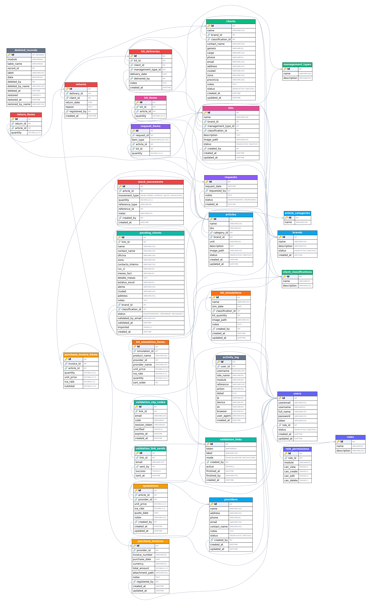

# Detallia — Scripts MySQL para el diagrama entidad-relación (DER)

Esta carpeta contiene el esquema **completo y actual** de Detallia en SQL de
MySQL, solo estructura (sin datos), listo para generar el DER en MySQL Workbench.

## Archivos

| Archivo | Qué contiene |
|---|---|
| `Detallia_mysql_01_estructura.sql` | Base de datos completa: `CREATE DATABASE detallia`, 29 tablas (InnoDB, utf8mb4) agrupadas por módulo y **46 llaves foráneas declaradas** al final. **Obligatorio.** |
| `Detallia_mysql_02_relaciones_logicas.sql` | **Opcional.** 2 relaciones que la app usa por nombre pero que la base no declara (papelera→usuario, ítem de simulador→proveedor). Cada una en su propio `ALTER TABLE`, por si quieres omitir alguna. |
| `Detallia_DER.png` / `Detallia_DER.svg` | Imagen del DER ya generada (29 tablas, color por módulo, 🔑 PK y 🔗 FK). Útil si no quieres abrir Workbench. El PNG es para ver/imprimir; el SVG escala sin perder nitidez. |

## Diagrama ya generado

Las imágenes `Detallia_DER.png` / `.svg` se generaron automáticamente desde
`Detallia_mysql_01_estructura.sql`. Para el DER editable e interactivo (mover
tablas, exportar a otros formatos) usa MySQL Workbench como se indica abajo.

## Cómo generar el DER en MySQL Workbench

1. Abre MySQL Workbench y conéctate a tu servidor MySQL (local o remoto).
2. **File ▸ Open SQL Script…** y abre `Detallia_mysql_01_estructura.sql`.
3. Ejecútalo con el **primer rayo** (Execute – `Ctrl+Shift+Enter`). Esto crea la
   base `detallia` con todas las tablas y llaves foráneas.
4. (Opcional) Abre y ejecuta igual `Detallia_mysql_02_relaciones_logicas.sql`
   si quieres que el diagrama muestre también las relaciones lógicas.
5. **Database ▸ Reverse Engineer…** (`Ctrl+R`), elige la conexión, y en la lista
   de esquemas marca **`detallia`**. Termina el asistente.
6. Workbench dibuja el **DER**. Puedes reacomodar las tablas y exportarlo con
   **File ▸ Export ▸ Export as PNG / PDF / SVG**.

> Alternativa sin crear la base: **File ▸ New Model**, luego
> **File ▸ Import ▸ Reverse Engineer MySQL Create Script…** y selecciona el
> archivo `01`. Genera el diagrama directo desde el script.

## Requisitos

- **MySQL 8.0 o superior.** La tabla `purchase_invoice_items` usa una columna
  **generada** `STORED` (`subtotal = quantity * unit_price`), soportada desde
  MySQL 5.7 / 8.0. Probado en MySQL **8.0.46**.
- Charset/collation: `utf8mb4` / `utf8mb4_unicode_ci`.

## Resumen del esquema

- **29 tablas**, todas con llave primaria propia (`id`).
- **46 llaves foráneas** declaradas (script 01) + **2 relaciones lógicas**
  opcionales (script 02) = 48 en total si ejecutas ambos.
- **1 columna generada** (`purchase_invoice_items.subtotal`).
- **0 restricciones CHECK** (el modelo no usa CHECK; las validaciones de rango,
  como el IVA, se hacen en la capa PHP).

### Módulos
1. Roles, usuarios y permisos (`roles`, `users`, `role_permissions`)
2. Proveedores, catálogo y marcas (`providers`, `brands`, `article_categories`, `articles`)
3. Compras y cotizaciones (`purchase_invoices`, `purchase_invoice_items`, `quotations`)
4. Clasificaciones, tipos de gestión y clientes (`management_types`, `client_classifications`, `clients`)
5. Kits y sus artículos (`kits`, `kit_items`)
6. Entregas, devoluciones e inventario (`kit_deliveries`, `stock_movements`, `returns`, `return_items`)
7. Solicitudes internas (`requests`, `request_items`)
8. Validación externa de contactos (`validation_links`, `pending_clients`, `validation_otp_codes`, `validation_link_sends`)
9. Simulador / costeo de kits (`kit_simulations`, `kit_simulation_items`)
10. Bitácora y papelera (`activity_log`, `deleted_records`)

## Notas de conversión y decisiones

El origen ya era MySQL/MariaDB (carpeta `database/`), por lo que **no hubo
conversión de tipos**. Sí se normalizó lo siguiente para Workbench:

- `int(11)` se escribe como `INT` (el ancho de visualización está obsoleto en
  MySQL 8). El tipo real es idéntico.
- Todas las llaves foráneas se agruparon en `ALTER TABLE` al final del script,
  con `SET FOREIGN_KEY_CHECKS=0/1` alrededor, para que el orden de creación de
  las tablas no importe.
- Los tipos de las columnas enlazadas por FK son idénticos (`INT` con `INT`).
  `deleted_records.id` es `INT UNSIGNED` (es su PK, no participa en ninguna FK).

### Relaciones que **no** se declaran como llave foránea
- `stock_movements.reference_id`: referencia **polimórfica** (según
  `reference_type` apunta a `purchase_invoices`, `kit_deliveries` o `returns`).
  No puede expresarse como una sola FK.
- `pending_clients → clients`: al "importar" un contacto, la app crea una fila
  en `clients` pero no guarda un id de enlace, así que no hay relación declarable.
- `deleted_records.deleted_by → users` y
  `kit_simulation_items.provider_id → providers`: existen por uso pero la app
  las deja sin FK; se incluyen como relaciones lógicas en el script 02.

## Fuente de verdad

Reconstruido a partir de `database/detallia_schema.sql` (base) y las migraciones
`database/01_*.sql … 26_*.sql`, aplicadas en orden cronológico (lo último manda).
No existe ORM; la estructura vive solo en esos scripts SQL.
